*Independent product build, January 2026 to present.*

**TL;DR**

- **Problem:** Nonprofits need to find the right funders and turn funder data into grant insights.
- **Approach:** A data pipeline over IRS Form 990 filings feeds a relational and vector database, with a retrieval-augmented generation (RAG) and multi-agent AI layer behind a web app.
- **Result:** A working platform in pilot with nonprofit organizations, where user feedback drives the roadmap. <!-- TODO(Jorge): add one concrete number (e.g., filings covered, organizations or funders covered, pilot users) -->

<!-- TODO(Jorge): add a screenshot or demo GIF of the app -->

## Problem

Nonprofits have to find funders that fit their mission and then write about their work in ways those funders respond to. The public data to support this exists as IRS Form 990 filings, but it's large and hard to use directly. Munay Works is an AI-enabled platform that helps nonprofits find funders and generate grant insights from that data. I'm building it independently, and this page covers the technical work.

## Architecture

{.architecture fig-alt="Vertical flow diagram: IRS Form 990 filings and IRS TEOS monthly files, ETL / ingestion, a relational and vector database with source and analytics layers, a RAG pipeline with a multi-agent layer, an API service, and a web app."}

**Stack:** web front end · Python API service · RAG pipeline · multi-agent architecture · vector database · relational database

## Data Pipeline

- **Sources:** IRS Form 990 filings, including the IRS TEOS monthly files, ingested through an ETL pipeline into a 990 database I built.
- **Two-layer schema:** source tables are kept separate from analytics tables, so raw filings stay untouched and the analytics layer can be rebuilt.
- **Materialized views** provide peer benchmarks and foundation profiles.

## AI Layer and How Outputs Are Evaluated

The AI layer is a RAG pipeline with a multi-agent architecture. Retrieval runs against a vector database alongside the relational data, so answers are grounded in actual filings and not generated from the model alone.

<!-- TODO(Jorge): describe how outputs are evaluated in general terms (e.g., test questions, grounding checks, human review) and add any eval metrics. None have been invented. -->

## What Pilots Taught Me

The platform is in a pilot with nonprofit organizations, and user feedback from the pilot drives the roadmap. <!-- TODO(Jorge): add 2–3 concrete lessons from the pilot (no organization names or contacts) -->

### Lessons From the Early Prototype

The first version, built in late 2025, was a RAG prototype backed by a vector store, with two modes: an advisory mode for grant-writing strategy, and a document mode where a user uploads an RFP, retrieves from it, and drafts responses. What carried forward:

- Clearly separating the advisory and document modes improved the user experience.
- RAG relevance depends on high-quality chunking and metadata.
- Local model support balances privacy and performance tradeoffs.

## What's Next

<!-- TODO(Jorge): next steps / roadmap, as much as you want to share publicly -->

The roadmap follows what pilot users ask for.

<!-- TODO(Jorge): add a Code section if there's a public repo for Munay Works. A link to an earlier prototype repo was removed; revisit once that repo's README is updated. -->
